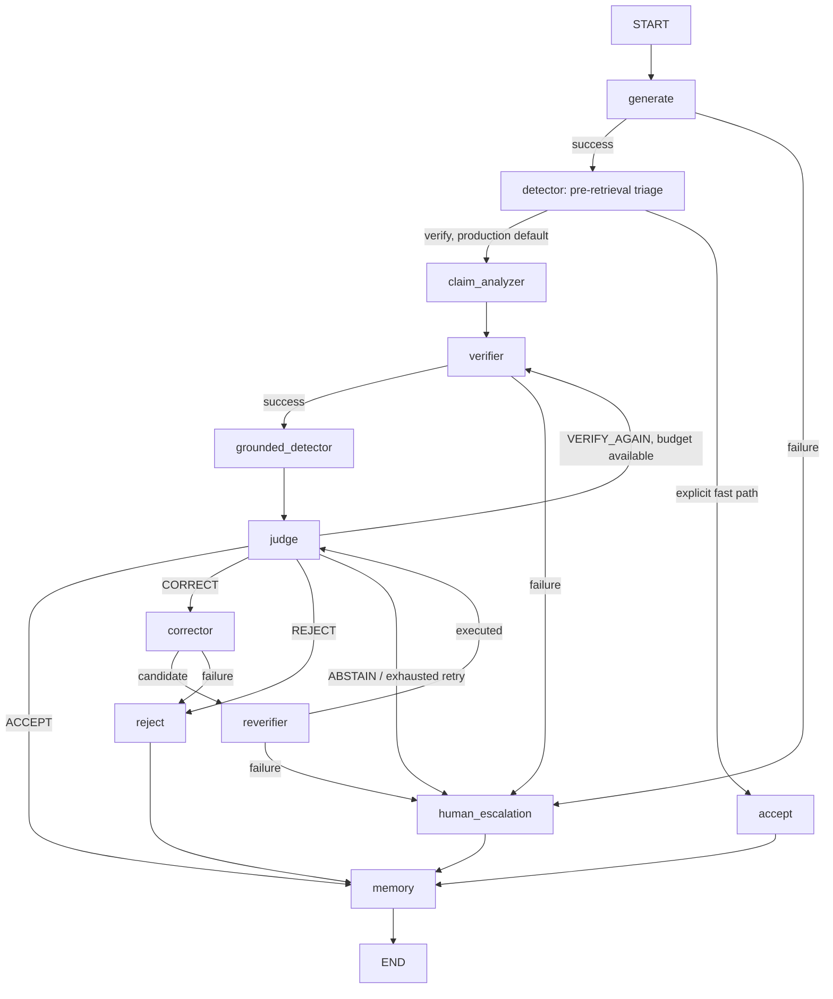

# LangGraph orchestration

`orchestration/` is HalluciGuard's control plane. It owns execution order, canonical state, bounded retries, terminal routing, errors, trace events, and the product FastAPI surface. It does not decide factual truth by itself.

## Actual production graph



The graph contains two Detector boundaries. Before retrieval it performs sentence triage and routes factual content without inventing a truth probability. After the Verifier returns, `grounded_detector` passes available evidence to the existing `artifacts/detector-best` checkpoint and replaces the triage result before Judge. The configured model path can override that default. Grounded neural inference requires usable evidence and successful model loading; a node invocation alone does not establish that inference ran. Inspect `model_loaded`, `inference_executed`, availability and degraded fields. Reported verification risk can include insufficient evidence and deterministic guard adjustments; it is not proof of factual incorrectness or evidence of improved calibration.

## Package map

| File | Responsibility |
|---|---|
| `graph.py` | Nodes, conditional edges, retries, correction/reverification loop, terminal state |
| `state.py` | `HalluciGuardState`, trace, error and inter-agent bus helpers |
| `schemas.py` | Canonical Detector, Verifier, Judge, Corrector, ReVerifier and Memory contracts |
| `detector_bridge.py` | Single adapter for triage and grounded trained-model execution |
| `api.py` | Authentication, history, health, `/verify`, and `/api/v1/verify` |
| `auth.py` | SQLite account/history support and JWT handling |
| `runtime_validation.py` | Configuration, detector artifact and verifier runtime checks |
| `intent.py` | Query intent/domain support |
| `scripts/verify_e2e.py` | Command-line E2E helper |
| `tests/` | Graph, contract, failure, retry and integration regressions |

## State and contracts

`HalluciGuardState` carries request IDs, query, candidate response, claim analysis, detector results, Verifier reports, Judge decision, correction/reverification state, memory result, retry counters, errors, bus messages and trace events.

Pydantic contracts in `schemas.py` are the authoritative inter-agent boundary. Legacy dictionaries remain for compatibility and human-readable display. Unknown verdicts and invalid states fail closed rather than being converted into success.

## Routing invariants

- `ALWAYS_VERIFY=true` is the production default.
- A Detector fast path requires `ALLOW_DETECTOR_FAST_PATH=true` and `ALWAYS_VERIFY=false`.
- Those opt-in flags alone are insufficient: the route also requires a valid Phase 1 eligibility record, compatible head/calibration identifiers and complete finite risk scores. Failed, malformed or unknown Detector outputs must not become permission to bypass verification. Keep the fast path disabled unless independently validated.
- `VERIFY_AGAIN` is bounded by `max_retries`.
- `CORRECT` is bounded by the correction attempt budget.
- Corrected content must pass ReVerifier before Judge may accept it.
- Every terminal route crosses Memory, but Memory writes only Judge-accepted verified facts.
- Detector failure with a valid generated response continues toward the Verifier; it does not discard the independent evidence verdict. Verification/retrieval failures can withhold or escalate the answer, never manufacture a verified-looking result.

## Reproducible narrated execution

From the repository root, after dependencies, local provider credentials, retrieval services and the existing checkpoint are available:

```powershell
python test_walkthrough.py "Who founded Microsoft?" --checkpoint artifacts/detector-best
```

This is a real query-only graph run: the Base LLM generates the answer. The runner prints the actual route and saves the full walkthrough, separate agent TXT reports and observed JSON handoffs in a fresh timestamped Downloads directory. It does not force every agent to run. The seven downstream agents are Detector, Claim Analyzer, Verifier, Judge, Corrector, ReVerifier and Memory; the Generator is reported separately.

To exercise correction using an explicitly wrong initial answer:

```powershell
python test_walkthrough.py "Who founded Microsoft?" --draft "Snehith is the founder of Microsoft." --checkpoint artifacts/detector-best
```

Only this diagnostic bypasses initial generation. Retrieval must still supply decision-grade evidence, Judge must request correction, and the candidate must pass independent re-verification before release. The ReVerifier re-extracts the corrected answer, adds missing source assertions from the deterministic extraction backstop where applicable, and requires complete returned claim coverage and supported verdicts. This is a coverage safeguard, not proof that extraction is semantically exhaustive.

The runner observes original methods without replacing verdicts or thresholds, uses isolated Memory/trust/cache files in `<report-directory>/runtime/`, disables verification caching and enforces verification-first flags. A Memory node can be reached while persistence is skipped; inspect its status and stored fact IDs separately. Original production Memory stores and existing checkpoints are not overwritten.

`FIRED` means execution, not correctness; `FAILED`, `NOT_FIRED` and `NOT_REQUIRED` retain their distinct meanings. Raw neural NLI scores, relation-adjusted decision scores, actual retrieval backends and fallbacks are distinct diagnostics. Selected passages do not establish complete tokenizer survival. Exit code 0 means the runner/export completed, not a production-readiness certification.

See [`../scripts/README.md`](../scripts/README.md) for suite/replay commands and every report filename. Keep generated reports, runtime databases and credentials local; they are not part of the source commit.

## API

```powershell
uvicorn orchestration.api:app --host 0.0.0.0 --port 8000
```

The product request accepts a `user_query`, `generation_mode`, and optional domain/history fields. Supplying an existing `llm_response` remains a compatibility/testing path; the query-only demo invokes the Base LLM normally.

See [`../docs/api.md`](../docs/api.md) and [`../docs/architecture.md`](../docs/architecture.md).
